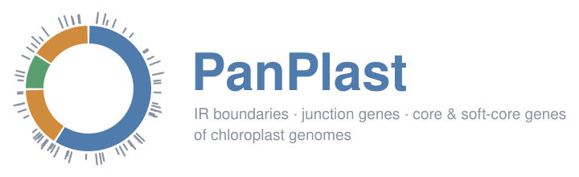
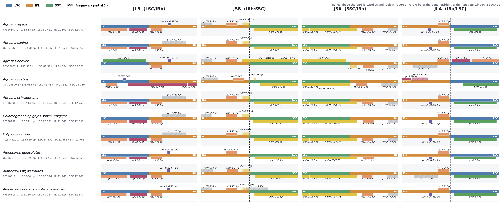
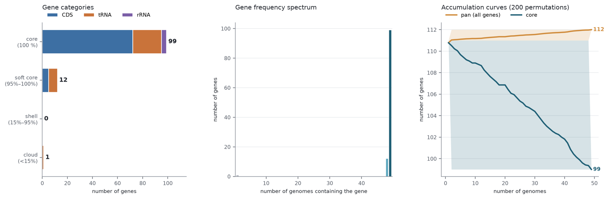
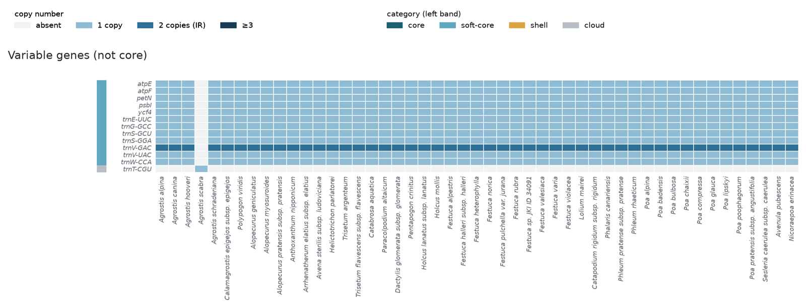
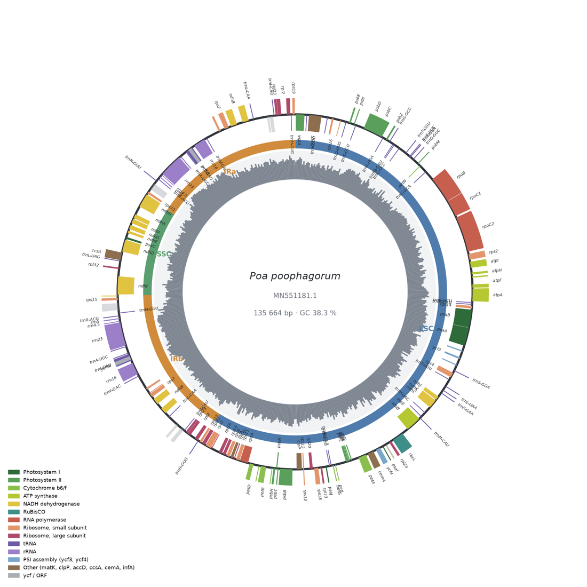
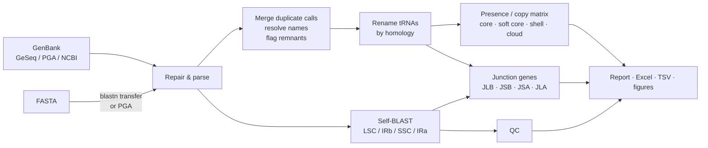

<p align="center">
  
</p>

<p align="center">
  <a href="#installation"></a>
  <a href="https://blast.ncbi.nlm.nih.gov/doc/blast-help/downloadblastdata.html"></a>
  <a href="LICENSE"></a>
  
  
</p>

<p align="center">
  <b>One command turns a folder of plastomes into IRscope-style junction plots, core / soft-core gene sets,<br>
  publication-ready figures, an Excel workbook and an interactive HTML report.</b>
</p>

<p align="center">
  <a href="#quick-start">Quick start</a> ·
  <a href="#installation">Installation</a> ·
  <a href="#what-you-get">What you get</a> ·
  <a href="#why-panplast">Why PanPlast</a> ·
  <a href="#usage">Usage</a> ·
  <a href="#how-it-works">How it works</a> ·
  <a href="#faq--troubleshooting">FAQ</a>
</p>

---

<table>
  <tr>
    <td width="50%" align="center"><b>Genes at the LSC / IR / SSC junctions</b><br></td>
    <td width="50%" align="center"><b>Core, soft-core, shell and cloud genes</b><br></td>
  </tr>
  <tr>
    <td align="center"><b>Genes that vary across the dataset</b><br></td>
    <td align="center"><b>Circular map of every genome</b><br></td>
  </tr>
</table>

<p align="center"><sub>Real output for 49 Pooideae plastomes annotated with GeSeq.</sub></p>

## Quick start

```bash
git clone https://github.com/sshskrbna/PanPlast.git
cd PanPlast
conda env create -f environment.yml
conda activate panplast
pip install -e .

panplast --genbank geseq_results/ --fasta genomes/ --meta metadata.tsv --out results/
open results/report.html        # Linux: xdg-open results/report.html
```

49 plastomes take about 3 minutes on a laptop.

## Features

| | |
|---|---|
| **IR boundaries from the sequence itself** | LSC / IRb / SSC / IRa come from self-BLAST of the inverted repeat, which also works when the IR spans the start of the sequence. Boundaries in the GenBank file are only used for comparison. |
| **Junction genes** | Genes crossing or flanking JLB, JSB, JSA and JLA, with the number of bp on each side, as a table and as an IRscope-style figure. |
| **Core / soft-core genes** | Presence and copy-number matrix, core / soft-core / shell / cloud categories with adjustable thresholds, frequency spectrum, accumulation curves. |
| **Clean gene names** | Synonyms, ambiguous GeSeq names, misread tRNA anticodons, fragments and gene remnants are resolved, so that one gene means one row. |
| **Raw FASTA too** | Genomes without annotation are annotated by transferring genes from reference GenBank files (blastn), or with PGA. |
| **Quality control** | Flags draft assemblies (N content), reverse-complemented LSC/SSC, missing genes, and IR boundaries that disagree with the annotation. |
| **Ready to publish** | PNG, PDF and SVG figures with editable text, an Excel workbook, TSV tables, and a self-contained HTML report with sortable tables. |

## Installation

PanPlast is a Python package. The only external program it needs is **BLAST+** (`blastn`).
It runs on macOS and Linux; on Windows use [WSL](https://learn.microsoft.com/windows/wsl/install).

### Option A: conda / mamba (recommended)

One environment with Python, all libraries and BLAST+.

1. Install [Miniforge](https://github.com/conda-forge/miniforge) if you don't have `conda` or `mamba` yet.
2. Clone the repository:

   ```bash
   git clone https://github.com/sshskrbna/PanPlast.git
   cd PanPlast
   ```

3. Create the environment and install PanPlast into it:

   ```bash
   conda env create -f environment.yml     # or: mamba env create -f environment.yml
   conda activate panplast
   pip install -e .
   ```

4. Check that both tools are found:

   ```bash
   panplast --version
   blastn -version
   ```

### Option B: pip + BLAST+ from your system

1. Install BLAST+:

   | System | Command |
   |---|---|
   | macOS (Homebrew) | `brew install blast` |
   | Debian / Ubuntu | `sudo apt install ncbi-blast+` |
   | Anything else | binaries from [NCBI](https://ftp.ncbi.nlm.nih.gov/blast/executables/blast+/LATEST/) |

2. Install PanPlast in a virtual environment:

   ```bash
   git clone https://github.com/sshskrbna/PanPlast.git
   cd PanPlast
   python3 -m venv .venv
   source .venv/bin/activate
   pip install -e .
   ```

3. Check it: `panplast --version` and `blastn -version`.

<details>
<summary><b>Requirements</b></summary>

| Software | Version | |
|---|---|---|
| Python | ≥ 3.9 | |
| BLAST+ (`blastn`) | ≥ 2.10 | required |
| biopython, pandas, numpy, matplotlib, openpyxl | see `pyproject.toml` | installed automatically |
| [PGA](https://github.com/quxiaojian/PGA) + Perl | any | only for `--pga` |

Without installing, you can also run `python3 -m panplast ...` from the repository folder once the dependencies are present.
</details>

## What you get

```
results/
├── report.html                  ← start here: interactive report with every figure and table
├── panplast_results.xlsx        all tables, one sheet each
├── tables/                      the same tables as TSV
├── figures/
│   ├── ir_junctions.{png,pdf,svg}
│   ├── core_softcore.{png,pdf,svg}
│   ├── gene_matrix.{png,pdf,svg}           all genes
│   ├── gene_matrix_variable.{png,pdf,svg}  only genes that are not core
│   ├── region_lengths.{png,pdf,svg}
│   └── maps/<accession>_<species>.{png,pdf}
├── annotated_genbank/           only when FASTA files were annotated
└── run.log
```

<details>
<summary><b>Tables</b></summary>

| File / sheet | One row per | Contents |
|---|---|---|
| `summary` | genome | length; LSC, IRb, SSC, IRa length; GC of each region; N content; IR identity; numbers of genes, PCGs, tRNAs and rRNAs; genes duplicated in the IR |
| `categories` | gene | type, functional group, number and % of genomes, category, min / max copies, genomes where it is absent |
| `matrix` | gene | copy number in each genome (2 = duplicated in the IR) |
| `junction_genes` | gene × junction | crossing / left / right, distance to the junction, bp on each side, coordinates |
| `region_coords` | genome | start and end of each region and position of each junction |
| `genes_all` | locus | final name, name in the GenBank, flags (fragment, partial, renamed, ...), candidate names, annotators |
| `qc` | issue | level and description |
| `trna_renamed` | tRNA | old and new name, identity and coverage of the homolog |
</details>

<details>
<summary><b>Reading the junction figure</b></summary>

Each row is a genome and each column is one junction: **JLB** (LSC/IRb), **JSB** (IRb/SSC), **JSA** (SSC/IRa)
and **JLA** (IRa/LSC), shown ±`--window` bp (1200 by default).

- The coloured bar is the region (LSC blue, IR orange, SSC green); the dashed line is the junction.
- Genes on the forward strand are drawn above the bar, genes on the reverse strand below it.
- `rps19 36|243`: the gene crosses the junction, 36 bp on the left and 243 bp on the right.
- `trnH-GUG 477 bp`: the gene is 477 bp away from the junction.
- Hatched gene marked `*`: a fragment or partial copy, such as the IR-duplicated end of *ndhH* or *ycf1*.
</details>

<details>
<summary><b>Gene categories</b></summary>

| Category | Present in | Option |
|---|---|---|
| core | 100 % of genomes | `--core 1.0` |
| soft core | ≥ 95 % and < 100 % | `--soft-core 0.95` |
| shell | ≥ 15 % and < 95 % | `--shell 0.15` |
| cloud | < 15 % | |

The report also gives *soft core including core* (≥ 95 %), the definition many papers use.
For Roary-style categories (core ≥ 99 %) use `--core 0.99`.

A gene counts as present when at least one complete copy is annotated. Fragments, remnants, `/pseudo` genes
(unless `--include-pseudo`), tRNAs without an anticodon and genes in `--exclude` stay in `genes_all` with their
flags, but are not counted.
</details>

<details>
<summary><b>QC levels</b></summary>

| Level | Examples |
|---|---|
| error | IR not found; more than 1 % N, i.e. a draft assembly whose genes inside gaps cannot be found |
| check | soft-core genes missing from this genome; LSC or SSC deposited reverse-complemented |
| note | IR from self-BLAST differs from the GenBank annotation; GenBank has no region annotation; non-standard tRNA names |
</details>

## Why PanPlast

Annotators such as GeSeq, PGA, CPGAVAS2 and Chloë annotate one genome at a time. Comparing dozens of plastomes
means reconciling their output, and the raw output has problems that change the numbers:

| Problem in annotator output | What PanPlast does |
|---|---|
| IR truncated when it spans the start of the sequence (GeSeq / OGDRAW cut 0.6–1.9 kb in the example data) | Boundaries from self-BLAST, which follows the repeat across the origin; differences reported in QC |
| One gene, several names: `pafI` / `ycf3`, `pbf1` / `psbN`, `clpP1` / `clpP`, `trnfM` / `trnfM-CAU` | Built-in synonym table, extendable with `--synonyms` |
| Ambiguous names: `trnM-CAU \| trnfM-CAU`, `trnT-CGU \| trnY-AUA \| trnI-GAU` | Resolved from evidence: plastid tRNA whitelist + BLAT scores from GeSeq `/info` |
| ARAGORN misreads the anticodon of intron-containing tRNAs (trnG-UCC → "trnS-CGA") | Renamed after the best homolog in the other genomes |
| Remnants of lost genes annotated as genes (accD, ycf1, ycf2 in grasses) | CDS shorter than half the typical length marked *partial*, not counted |
| The same gene annotated several times (exons + whole span, several annotators) | Overlapping calls merged into one locus |
| Broken locations such as `136376..0` that make Biopython fail | Repaired while reading |

## Usage

### Input

Inputs can be mixed. Files are matched to genomes by accession, found in the file name or the record ID
(e.g. `MN551181.1`).

| Option | What | Notes |
|---|---|---|
| `--genbank` | annotated GenBank files or folders (`.gb`, `.gbk`, `.genbank`, `.gbff`) | GeSeq `*_GenBank.gb`, PGA output, NCBI records. GeSeq `/info` evidence is used to resolve names. |
| `--fasta` | FASTA files or folders, one genome per file | Used only for labels when a GenBank of the same accession is given; otherwise annotated. |
| `--meta` | TSV with `accession` (or `file`), `species`, optional `group` / `subtribe` | Sets species labels and the order of genomes (by group, then species). |

```tsv
accession	species	group
MN551181.1	Poa poophagorum	Poinae
PP316507.1	Agrostis alpina	Agrostidinae
```

Without `--meta`, labels come from the `ORGANISM` line or the file name: `MN551181.1_Poa_poophagorum.fasta` becomes
*Poa poophagorum*.

### Options

```
input / output
  --genbank PATH ...     annotated GenBank files or folders
  --fasta PATH ...       FASTA files or folders (annotated if they have no GenBank)
  --meta TSV             accession/file, species, optional group/subtribe
  --out DIR              output folder [panplast_results]

annotation of FASTA
  --ref GB ...           reference GenBank files [first 3 of --genbank]
  --pga PGA.pl           use PGA instead of the built-in blastn transfer

genes
  --core 1.0             core threshold (fraction of genomes)
  --soft-core 0.95       soft-core threshold
  --shell 0.15           shell threshold
  --synonyms TSV         extra synonyms: old_name<TAB>new_name
  --exclude LIST         genes to ignore, e.g. ycf68,ycf15
  --include-pseudo       count genes marked /pseudo
  --min-cds-frac 0.5     CDS shorter than this × typical length = remnant

boundaries and figures
  --ir-source {blast,genbank}   IR from self-BLAST (default) or from the annotation
  --min-ir 5000          shortest repeat accepted as the IR, bp
  --window 1200          bp shown on each side of a junction
  --maps -1              circular maps to draw (-1 = all, 0 = none)
```

### Recipes

<details open>
<summary><b>A dataset annotated with GeSeq</b></summary>

1. Upload the FASTA files to [GeSeq](https://chlorobox.mpimp-golm.mpg.de/geseq.html) with *annotate IR* on and
   GenBank among the output formats. Use the same settings and references for all genomes.
2. Unpack the results archive into one folder.
3. Run:

   ```bash
   panplast --genbank geseq_results/ --fasta genomes/ --meta metadata.tsv --out results/
   ```
</details>

<details>
<summary><b>Only FASTA, annotated from references</b></summary>

Pick 2–5 well-annotated plastomes of related species:

```bash
panplast --fasta genomes/ --ref refs/Poa_annua.gb refs/Festuca_ovina.gb --out results/
```

The built-in transfer reproduces gene content, copy number and positions, which is all the boundary and core-gene
analyses need. Exon borders are not refined, so do not submit these GenBank files to NCBI.
</details>

<details>
<summary><b>Annotate FASTA with PGA</b></summary>

Install [PGA](https://github.com/quxiaojian/PGA), then:

```bash
panplast --fasta genomes/ --ref refs/ --pga ~/tools/PGA/PGA.pl --out results/
```

PanPlast runs `perl PGA.pl -r <refs> -t <fasta> -o <out>` and reads the result. This branch has not been tested
against every PGA version.
</details>

<details>
<summary><b>Your own naming conventions</b></summary>

```bash
printf "orf42\tycf68\nlhbA\tpsbZ\n" > synonyms.tsv
panplast --genbank gb/ --synonyms synonyms.tsv --exclude ycf68,ycf15 --out results/
```
</details>

<details>
<summary><b>Roary-style thresholds, wider junction window, no maps</b></summary>

```bash
panplast --genbank gb/ --core 0.99 --soft-core 0.95 --window 2000 --maps 0 --out results/
```
</details>

<details>
<summary><b>Plastomes with a reduced inverted repeat</b></summary>

```bash
panplast --genbank gb/ --min-ir 1000 --out results/
```

Genomes that lost one IR copy (e.g. the IR-lacking clade of legumes) are reported as *IR not found*;
their genes are still counted.
</details>

## How it works



1. **Reading.** GenBank files are repaired (origin-wrapping and `..0` locations) and parsed with Biopython.
2. **Loci.** Each `gene` feature is paired with its `CDS` / `tRNA` / `rRNA` feature to get the exon structure.
   Overlapping calls of the same type are merged into one locus: mutually ≥ 50 %, nested, or any same-strand overlap
   for RNA genes.
3. **Names.** Candidates are normalised (synonyms, `-fragment`, anticodon case, `rrn16S` → `rrn16`). The
   best-supported candidate wins. Its score combines the plastid tRNA whitelist, the BLAT psl score, the call of an
   anticodon-based predictor, and being the only name given.
4. **Remnants.** A CDS shorter than `--min-cds-frac` × its typical length is flagged *partial*.
5. **tRNA homology.** tRNAs with non-standard names are BLASTed against the well-named tRNAs of the other genomes
   and take the name of the best homolog covering ≥ 90 % of it.
6. **Inverted repeat.** Each genome is BLASTed against its reverse complement, as given and rotated by a third, so an
   IR spanning the origin is found intact. Collinear HSPs are chained. The longest chain (≥ `--min-ir`) is the IR,
   and the larger single-copy region is the LSC.
7. **Junction genes.** For each junction, genes crossing it and the two nearest genes on each side within 3 kb.
8. **Statistics.** Presence / copy matrix, categories, frequency spectrum, accumulation curves (200 permutations).

## FAQ & troubleshooting

| Message / symptom | Fix |
|---|---|
| `BLAST+ (blastn) must be on PATH` | Activate the conda environment, or install BLAST+ (see [Installation](#installation)) |
| `command not found: panplast` | Activate the environment where you ran `pip install -e .`, or use `python3 -m panplast` |
| A genome misses many genes, QC says "% N" | Draft assembly: the genes are in the gaps. Exclude or replace the genome |
| QC: "LSC reverse-complemented" | The record has the LSC in the opposite orientation; reorient it before comparing junctions |
| QC: "self-BLAST and GenBank boundaries differ" | Usually the annotator truncated the IR at the origin. Check `region_coords`; `--ir-source genbank` keeps the annotation's boundaries |
| A gene I expect is absent | Find it in `tables/genes_all.tsv`: the `flags` column says if it was a fragment, partial, pseudo or unresolved |
| Matplotlib font warnings | Harmless |

## Development

```bash
pip install -e ".[test]"
python -m pytest              # or: python -m unittest discover -s tests
```

The tests build synthetic plastomes and cover name resolution, remnant detection, GenBank repair, IR detection across
the origin, category thresholds and a full end-to-end run.

```
panplast/
├── cli.py         command line and orchestration
├── genes.py       GenBank parsing, name resolution, merging of duplicate calls
├── ir.py          self-BLAST inverted-repeat detection
├── reconcile.py   tRNA renaming by homology
├── annotate.py    FASTA annotation (blastn transfer / PGA)
├── analysis.py    junction genes, summaries, categories, accumulation curves
├── plots.py       all figures
├── report.py      HTML report
└── text.py        user-facing strings
```

## Citation

If you use PanPlast in a publication, please also cite the tools it builds on:

- **BLAST+**: Camacho C. et al. (2009) BLAST+: architecture and applications. *BMC Bioinformatics* 10: 421.
- **Biopython**: Cock P. J. A. et al. (2009) *Bioinformatics* 25: 1422–1423.
- your annotator, e.g. **GeSeq**: Tillich M. et al. (2017) *Nucleic Acids Res.* 45: W6–W11;
  **PGA**: Qu X.-J. et al. (2019) *Plant Methods* 15: 50.

The junction figure follows the layout popularised by **IRscope**: Amiryousefi A. et al. (2018)
*Bioinformatics* 34: 3030–3031.

## License

[MIT](LICENSE) © 2026 Alexandra Skryabina
