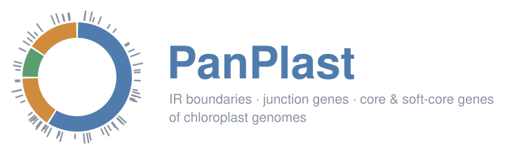
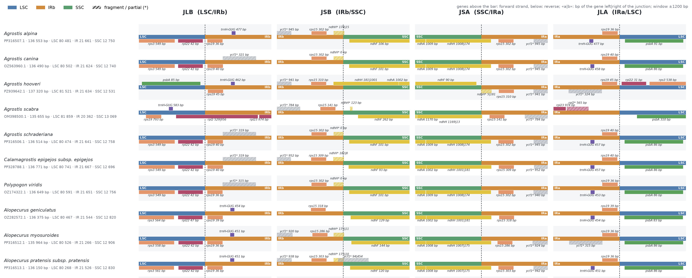
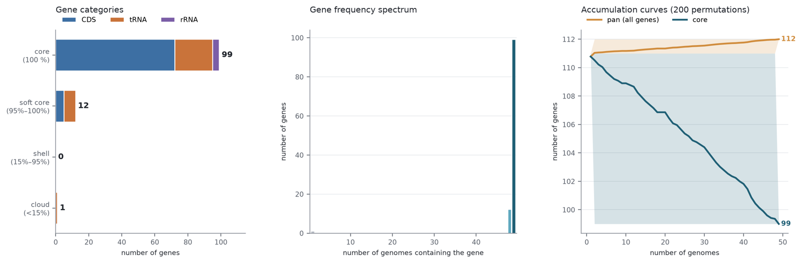
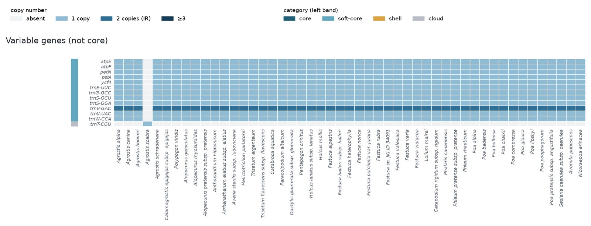
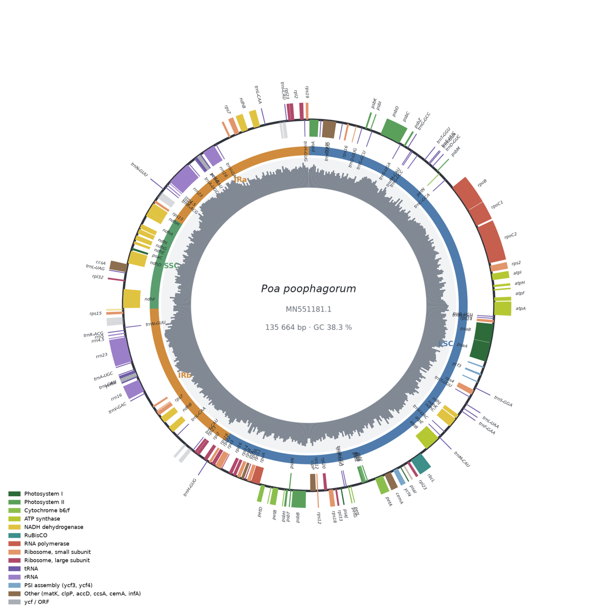
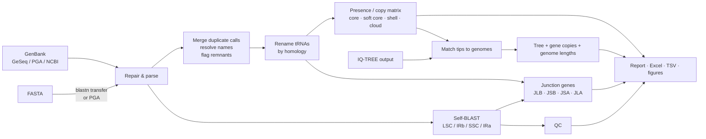

<p align="center">
  
</p>

<p align="center">
  <a href="#installation"></a>
  <a href="https://blast.ncbi.nlm.nih.gov/doc/blast-help/downloadblastdata.html"></a>
  <a href="LICENSE"></a>
  
  
</p>

<p align="center">
  <b>Compare plastome IR boundaries, junction genes and core / soft-core gene content.<br>
  Add an IQ-TREE phylogeny to display missing genes, copy numbers and genome sizes.<br>
  Get publication-ready figures, an Excel workbook and an interactive HTML report.</b>
</p>

<p align="center">
  <a href="#quick-start">Quick start</a> ·
  <a href="#installation">Installation</a> ·
  <a href="#what-you-get">What you get</a> ·
  <a href="#why-panplast">Why PanPlast</a> ·
  <a href="#usage">Usage</a> ·
  <a href="#genome-correlation-plots">Genome correlations</a> ·
  <a href="#iq-tree-phylogeny-and-missing-genes">IQ-TREE &amp; missing genes</a> ·
  <a href="#how-it-works">How it works</a> ·
  <a href="#faq--troubleshooting">FAQ</a>
</p>

---

<table>
  <tr>
    <td width="50%" align="center"><b>Genes at the LSC / IR / SSC junctions</b><br></td>
    <td width="50%" align="center"><b>Core, soft-core, shell and cloud genes</b><br></td>
  </tr>
  <tr>
    <td align="center"><b>Genes that vary across the dataset</b><br></td>
    <td align="center"><b>Circular map of every genome</b><br></td>
  </tr>
</table>

<p align="center"><sub>Real output for 49 Pooideae plastomes annotated with GeSeq.</sub></p>

## Quick start

```bash
git clone https://github.com/sshskrbna/PanPlast.git
cd PanPlast
conda env create -f environment.yml
conda activate panplast
pip install -e .

panplast --genbank geseq_results/ --fasta genomes/ --meta metadata.tsv --out results/
open results/report.html        # Linux: xdg-open results/report.html
```

49 plastomes take about 3 minutes on a laptop.

To include an existing IQ-TREE phylogeny in the same analysis:

```bash
panplast --genbank geseq_results/ --meta metadata.tsv \
  --tree plastome.contree --out results_with_tree/
open results_with_tree/report.html
```

Use `--tree-genes ycf1,ycf2,accD,infA` to show specific genes, or omit it to select pan-genes
missing in at least one matched genome. See [IQ-TREE and missing genes](#iq-tree-phylogeny-and-missing-genes)
for taxon mapping, colour meanings and output files.

## Features

| | |
|---|---|
| **IR boundaries from the sequence itself** | LSC / IRb / SSC / IRa come from self-BLAST of the inverted repeat, which also works when the IR spans the start of the sequence. Boundaries in the GenBank file are only used for comparison. |
| **Junction genes** | Genes crossing or flanking JLB, JSB, JSA and JLA, with the number of bp on each side, as a table and as an IRscope-style figure. |
| **Core / soft-core genes** | Presence and copy-number matrix, core / soft-core / shell / cloud categories with adjustable thresholds, frequency spectrum, accumulation curves. |
| **Clean gene names** | Synonyms, ambiguous GeSeq names, misread tRNA anticodons, fragments and gene remnants are resolved, so that one gene means one row. |
| **Raw FASTA too** | Genomes without annotation are annotated by transferring genes from reference GenBank files (blastn), or with PGA. |
| **Quality control** | Flags draft assemblies (N content), reverse-complemented LSC/SSC, missing genes, and IR boundaries that disagree with the annotation. |
| **Ready to publish** | PNG, PDF and SVG figures with editable text, an Excel workbook, TSV tables, and a self-contained HTML report with sortable tables. |
| **Gene absence on a phylogeny** | Load IQ-TREE trees and align them with missing-gene / copy-number heatmaps, IR and genome lengths, and taxonomic groups. |
| **Genome correlations** | Gene count vs. plastome size, plastome size vs. IR length, and gene count vs. IR length, with labelled taxa, group colours, regression lines and confidence intervals. |

## Installation

PanPlast is a Python package. The only external program it needs is **BLAST+** (`blastn`).
It runs on macOS and Linux; on Windows use [WSL](https://learn.microsoft.com/windows/wsl/install).

### Option A: conda / mamba (recommended)

One environment with Python, all libraries and BLAST+.

1. Install [Miniforge](https://github.com/conda-forge/miniforge) if you don't have `conda` or `mamba` yet.
2. Clone the repository:

   ```bash
   git clone https://github.com/sshskrbna/PanPlast.git
   cd PanPlast
   ```

3. Create the environment and install PanPlast into it:

   ```bash
   conda env create -f environment.yml     # or: mamba env create -f environment.yml
   conda activate panplast
   pip install -e .
   ```

4. Check that both tools are found:

   ```bash
   panplast --version
   blastn -version
   ```

### Option B: pip + BLAST+ from your system

1. Install BLAST+:

   | System | Command |
   |---|---|
   | macOS (Homebrew) | `brew install blast` |
   | Debian / Ubuntu | `sudo apt install ncbi-blast+` |
   | Anything else | binaries from [NCBI](https://ftp.ncbi.nlm.nih.gov/blast/executables/blast+/LATEST/) |

2. Install PanPlast in a virtual environment:

   ```bash
   git clone https://github.com/sshskrbna/PanPlast.git
   cd PanPlast
   python3 -m venv .venv
   source .venv/bin/activate
   pip install -e .
   ```

3. Check it: `panplast --version` and `blastn -version`.

<details>
<summary><b>Requirements</b></summary>

| Software | Version | |
|---|---|---|
| Python | ≥ 3.9 | |
| BLAST+ (`blastn`) | ≥ 2.10 | required |
| biopython, pandas, numpy, scipy, matplotlib, openpyxl | see `pyproject.toml` | installed automatically |
| [PGA](https://github.com/quxiaojian/PGA) + Perl | any | only for `--pga` |

Without installing, you can also run `python3 -m panplast ...` from the repository folder once the dependencies are present.
Reading existing IQ-TREE output uses Biopython, which is already included; it does not require an IQ-TREE executable.
</details>

### Updating an existing installation

From your PanPlast checkout, with its Python environment activated:

```bash
git pull --ff-only
pip install -e .
panplast --help
```

The help output should include `--tree`, `--tree-map` and `--tree-genes`.

## What you get

```
results/
├── report.html                  ← start here: interactive report with every figure and table
├── correlations.html            the three correlation plots on a separate, self-contained page
├── panplast_results.xlsx        all tables, one sheet each
├── tables/                      the same tables as TSV
├── figures/
│   ├── ir_junctions.{png,pdf,svg}
│   ├── core_softcore.{png,pdf,svg}
│   ├── gene_matrix.{png,pdf,svg}           all genes
│   ├── gene_matrix_variable.{png,pdf,svg}  genes with variable presence or copy number
│   ├── region_lengths.{png,pdf,svg}
│   ├── genes_vs_genome.{png,pdf,svg}
│   ├── genome_vs_ir.{png,pdf,svg}
│   ├── genes_vs_ir.{png,pdf,svg}
│   ├── phylogeny_1.{png,pdf,svg}           when --tree is supplied (paginated if >30 genes)
│   └── maps/<accession>_<species>.{png,pdf}
├── annotated_genbank/           only when FASTA files were annotated
└── run.log
```

<details>
<summary><b>Tables</b></summary>

| File / sheet | One row per | Contents |
|---|---|---|
| `summary` | genome | length; LSC, IRb, SSC, IRa length; GC of each region; N content; IR identity; numbers of genes, PCGs, tRNAs and rRNAs; genes duplicated in the IR |
| `categories` | gene | type, functional group, number and % of genomes, category, min / max copies, genomes where it is absent |
| `matrix` | gene | copy number in each genome (2 = duplicated in the IR) |
| `junction_genes` | gene × junction | crossing / left / right, distance to the junction, bp on each side, coordinates |
| `region_coords` | genome | start and end of each region and position of each junction |
| `genes_all` | locus | final name, name in the GenBank, flags (fragment, partial, renamed, ...), candidate names, annotators |
| `qc` | issue | level and description |
| `trna_renamed` | tRNA | old and new name, identity and coverage of the homolog |
| `taxon_styles` / `Taxon colours` | genome | resolved species label, group, colour category, exact colour and figure label |
| `scatter_points` / `Scatterplot data` | genome | plotted genome / IR sizes, gene count and count mode, group, highlighted gene copy number and selected-genome marker |
| `correlations` / `Correlations` | comparison | valid pairs, excluded rows, Pearson r, two-sided p, OLS slope / intercept, confidence level and fit status |
| `tree_taxa` / `Tree taxa` | tree × taxon | matched genome ID, species, group, matching method, unmatched tips and genomes outside the tree |
| `tree_absences` / `Tree absences` | tree × tip × missing gene | no annotated locus vs. an uncounted locus; fragment / partial / pseudo / excluded flags |
| `tree_copies` / `Tree gene copies` | tree × tip × displayed gene | counted copies; blank means no matching genome, not gene absence |
</details>

The three `tree_*` tables are added only when `--tree` is supplied. Names before the slash are TSV
basenames; names after it are Excel sheet names. A paginated tree uses filenames such as
`phylogeny_1_1.png`, `phylogeny_1_2.png`; a second input tree uses the `phylogeny_2` prefix.

<details>
<summary><b>Reading the junction figure</b></summary>

Each row is a genome and each column is one junction: **JLB** (LSC/IRb), **JSB** (IRb/SSC), **JSA** (SSC/IRa)
and **JLA** (IRa/LSC), shown ±`--window` bp (1200 by default).

- The coloured bar is the region (LSC blue, IR orange, SSC green); the dashed line is the junction.
- Genes on the forward strand are drawn above the bar, genes on the reverse strand below it.
- `rps19 36|243`: the gene crosses the junction, 36 bp on the left and 243 bp on the right.
- `trnH-GUG 477 bp`: the gene is 477 bp away from the junction.
- Hatched gene marked `*`: a fragment or partial copy, such as the IR-duplicated end of *ndhH* or *ycf1*.
</details>

<details>
<summary><b>Gene categories</b></summary>

| Category | Present in | Option |
|---|---|---|
| core | 100 % of genomes | `--core 1.0` |
| soft core | ≥ 95 % and < 100 % | `--soft-core 0.95` |
| shell | ≥ 15 % and < 95 % | `--shell 0.15` |
| cloud | < 15 % | |

The report also gives *soft core including core* (≥ 95 %), the definition many papers use.
For Roary-style categories (core ≥ 99 %) use `--core 0.99`.

A gene counts as present when at least one complete copy is annotated. Fragments, remnants, `/pseudo` or `/pseudogene` loci
(unless `--include-pseudo`), tRNAs without an anticodon and genes in `--exclude` stay in `genes_all` with their
flags, but are not counted.
</details>

<details>
<summary><b>QC levels</b></summary>

| Level | Examples |
|---|---|
| error | no gene loci extracted; IR not found; more than 1 % N, i.e. a draft assembly whose genes inside gaps cannot be found |
| check | soft-core genes missing from this genome; LSC or SSC deposited reverse-complemented |
| note | IR from self-BLAST differs from the GenBank annotation; GenBank has no region annotation; non-standard tRNA names |
</details>

## Why PanPlast

Annotators such as GeSeq, PGA, CPGAVAS2 and Chloë annotate one genome at a time. Comparing dozens of plastomes
means reconciling their output, and the raw output has problems that change the numbers:

| Problem in annotator output | What PanPlast does |
|---|---|
| IR truncated when it spans the start of the sequence (GeSeq / OGDRAW cut 0.6–1.9 kb in the example data) | Boundaries from self-BLAST, which follows the repeat across the origin; differences reported in QC |
| One gene, several names: `pafI` / `ycf3`, `pbf1` / `psbN`, `clpP1` / `clpP`, `trnfM` / `trnfM-CAU` | Built-in synonym table, extendable with `--synonyms` |
| Ambiguous names: `trnM-CAU \| trnfM-CAU`, `trnT-CGU \| trnY-AUA \| trnI-GAU` | Resolved from evidence: plastid tRNA whitelist + BLAT scores from GeSeq `/info` |
| ARAGORN misreads the anticodon of intron-containing tRNAs (trnG-UCC → "trnS-CGA") | Renamed after the best homolog in the other genomes |
| Remnants of lost genes annotated as genes (accD, ycf1, ycf2 in grasses) | CDS shorter than half the typical length marked *partial*, not counted |
| The same gene annotated several times (exons + whole span, several annotators) | Overlapping calls merged into one locus |
| Broken locations such as `136376..0` that make Biopython fail | Repaired while reading |

## Usage

### Input

Inputs can be mixed. Files are matched to genomes by accession, found in the file name or the record ID
(e.g. `MN551181.1`).

| Option | What | Notes |
|---|---|---|
| `--genbank` | annotated GenBank files or folders (`.gb`, `.gbk`, `.genbank`, `.gbff`) | GeSeq `*_GenBank.gb`, PGA output, NCBI records. GeSeq `/info` evidence is used to resolve names. |
| `--fasta` | FASTA files or folders, one genome per file | Used only for labels when a GenBank of the same accession is given; otherwise annotated. |
| `--meta` | Optional TSV with `accession` (or `file`), `species`, optional `group` / `subtribe` / `section` and `color` | Overrides automatic species labels and supplies user colours. |
| `--tree` | one or more `.treefile`, `.contree`, Newick or `.iqtree` files | Adds gene-content overlays to existing phylogenies. |
| `--tree-map` | TSV with `tip`, `genome` | Links tree labels to exact PanPlast genome IDs when automatic matching is insufficient. |

```tsv
accession	species	group
MN551181.1	Poa poophagorum	Poinae
PP316507.1	Agrostis alpina	Agrostidinae
```

Without `--meta`, labels come from the `ORGANISM` line or the file name: `MN551181.1_Poa_poophagorum.fasta` becomes
*Poa poophagorum*.

### Metadata, species colours and labels

Metadata are optional. The same colour key is used for scatterplot points, tree tips and taxon labels
in the other figures. Region bars and gene-copy heatmap cells retain their own biological colour scales.

```bash
# Species names and optional custom colours from metadata:
panplast --genbank gb/ --meta metadata.tsv --color-by species \
  --tree phylogeny.contree --out results/

# No metadata: names come from GenBank/FASTA; colours are assigned automatically:
panplast --genbank gb/ --color-by species --tree phylogeny.contree --out results/

# Show accession IDs instead of species names in the figures:
panplast --genbank gb/ --color-by species --label-by accession --out results_ids/
```

| Flag | Effect |
|---|---|
| `--color-by species` | One colour per resolved species name; assemblies of the same species share a colour. |
| `--color-by group` | One colour per metadata group / subtribe / section (default). Without groups, use neutral grey. |
| `--color-by none` | A uniform taxon colour. |
| `--label-by species` | Species labels in figures (default); use the genome ID when no name is available. |
| `--label-by accession` | Genome IDs in figures; species names remain available for tree matching and tables. |

A minimal metadata file needs only `accession` and `species`. Add `color` to assign exact colours,
and optionally `group`, `subtribe` or `section`. See [the template](examples/taxon_metadata.tsv).
Use one colour per **selected category**: the same species must have one colour in species mode;
all genomes in a group must share a colour in group mode. Conflicting assignments fail with a diagnostic.
The resolved key is saved in `tables/taxon_styles.tsv` and the Excel sheet `Taxon colours`.
Unmatched tree tips stay grey. Colours are assigned from the full input dataset, so a tree containing
only a subset of those genomes keeps the same colours as the scatterplots.

### Options

```
input / output
  --genbank PATH ...     annotated GenBank files or folders
  --fasta PATH ...       FASTA files or folders (annotated if they have no GenBank)
  --meta TSV             optional accession/file, species, group/subtribe/section, color
  --color-by {species,group,none}  colour points, tree tips and taxon labels [group]
  --label-by {species,accession}   figure labels [species]
  --out DIR              output folder [panplast_results]

annotation of FASTA
  --ref GB ...           reference GenBank files [first 3 of --genbank]
  --pga PGA.pl           use PGA instead of the built-in blastn transfer

genes
  --core 1.0             core threshold (fraction of genomes)
  --soft-core 0.95       soft-core threshold
  --shell 0.15           shell threshold
  --synonyms TSV         extra synonyms: old_name<TAB>new_name
  --exclude LIST         genes to ignore, e.g. ycf68,ycf15
  --include-pseudo       count genes marked /pseudo
  --min-cds-frac 0.5     CDS shorter than this × typical length = remnant

boundaries and figures
  --ir-source {blast,genbank}   IR from self-BLAST (default) or from the annotation
  --min-ir 5000          shortest repeat accepted as the IR, bp
  --window 1200          bp shown on each side of a junction
  --maps -1              circular maps to draw (-1 = all, 0 = none)

genome correlations
  --gene-count {total,unique}  counted copies including IR, or unique gene names [total]
  --highlight-gene GENE       optional gene-status markers [none; disabled]
  --highlight-genomes LIST    exact genome IDs to mark with orange squares

phylogeny and missing genes
  --tree FILE ...       IQ-TREE .treefile / .contree, Newick, or .iqtree report
  --tree-map TSV        optional mapping with columns tip and genome
  --tree-genes LIST     canonical names, e.g. ycf1,ycf2,accD,infA
                        [default: pan-genes missing in at least one matched genome]
```

### Genome correlation plots

Every run produces three scatterplots, without needing a tree or a separate command. They appear
immediately after the summary in `report.html`, with a prominent link at the top. You can also open
`correlations.html` to view just these plots without scrolling past the other figures or tree tables:

| Figure | X | Y |
|---|---|---|
| `genes_vs_genome` | Total plastome size (kb) | Counted genes |
| `genome_vs_ir` | IRb length (kb) | Total plastome size (kb) |
| `genes_vs_ir` | IRb length (kb) | Counted genes |

```bash
panplast --genbank gb/ --meta metadata.tsv --out results/ \
  --gene-count total --color-by species

# Count unique gene names instead of copies:
panplast --genbank gb/ --meta metadata.tsv --out results_unique/ \
  --gene-count unique --color-by group
```

Colours follow `--color-by`; labels use `--label-by`, with accessions added when
abbreviated labels repeat. Points and species labels use the same saturated colour. The default palette
uses vivid blues, reds, greens, purples and oranges; ungrouped genomes use a neutral grey.
To keep exact group colours across datasets, add an optional `color` column to the metadata:

```tsv
accession	species	group	color
NC_000001.1	Species alpha	Group A	#4363d8
NC_000002.1	Species beta	Group B	#00a040
```

Use one valid Matplotlib colour (for example a hex value) per selected species or group. The chosen
colours are saved in `taxon_styles.tsv` and in `scatter_points.tsv`. The colour legend explains the
species/group categories; by default all points are circles, with no gene-status legend.

Gene counts are calculated from the presence / copy matrix: `total` sums counted copies including IR
copies; `unique` counts distinct names with at least one counted copy. Fragments and other uncounted
loci follow the same filters as the main analysis.

Gene-status highlighting is **off by default**: ordinary plots show only the distribution of gene
counts and lengths. If explicitly requested with, for example, `--highlight-gene infA`, circles
indicate a counted copy and triangles with red rings indicate no counted copy under the current filters.
Optional orange squares mark only IDs explicitly listed in `--highlight-genomes`; the program does
not infer IR collapse from that selection. Different assemblies remain separate points even when
their species names and colours match.

The dashed line is an ordinary least-squares fit; shading is the pointwise 95% confidence interval
for its **mean response**, not a prediction interval for individual genomes. Pearson `r`, nominal
two-sided `p` and the number of valid pairs `n` are calculated separately for each comparison.
Fits use only paired finite values; missing IR lengths remain missing. With fewer than three valid
pairs, or a constant X or Y variable, the points are retained and `r` / `p` are reported as undefined.
Exact statistics and plotted values are exported to `correlations.tsv`, `scatter_points.tsv` and Excel.
The implementation uses [SciPy's statistical routines](https://docs.scipy.org/doc/scipy/reference/generated/scipy.stats.linregress.html).

These are descriptive comparisons without phylogenetic correction or adjustment for multiple tests.
Total plastome length includes both IR copies, so its correlation with IR length partly reflects that
shared component. Neither the nominal p-value nor the regression alone establishes an evolutionary cause.

### IQ-TREE phylogeny and missing genes

Supply the tree already inferred by IQ-TREE; PanPlast renders it and overlays gene content:

```bash
panplast --genbank gb/ --meta metadata.tsv \
  --tree phylogeny.contree --out results/

# Display specific genes, including known genes absent from the entire dataset:
panplast --genbank gb/ --tree phylogeny.treefile \
  --tree-genes ycf1,ycf2,accD,infA --out results/

# Compare multiple trees against the same pan-genome:
panplast --genbank gb/ --tree plastome.contree marker.treefile --out results/
```

`.treefile` is the maximum-likelihood tree and `.contree` the consensus tree from IQ-TREE.
For a `.iqtree` report, PanPlast reads its first **Tree in newick format** section (the ML tree).
The input topology, tip order, branch lengths and support labels, including labels such as `88.5/99`,
are retained. Trees without complete usable branch lengths are drawn as cladograms. Trees are not rerooted.
No new alignment or IQ-TREE run is performed.

Tips are matched by exact genome ID, accession (also within a longer tip label), or a unique species
label with spaces / underscores treated equally. An accession without its version can match a unique
versioned ID. Ambiguous matches fail with a diagnostic rather than silently selecting a genome.
If the tree uses different IDs, provide a TSV using exact PanPlast genome IDs from `tables/summary.tsv`:

```tsv
tip	genome
sample_01	NC_000001.1
sample_02	NC_000002.1
```

```bash
panplast --genbank gb/ --tree phylogeny.contree --tree-map tree_map.tsv --out results/
```

`tip` must match the original tree label exactly. `genome` must match a genome ID from
`tables/summary.tsv`, including a version or a duplicate-ID suffix such as `_2` when present.
Each tree tip must map to at most one genome, and each genome to at most one tip within that tree.

Each tree produces PNG, PDF and SVG figures in `figures/phylogeny_<number>.*`, a section in the HTML
report, and three tables / Excel sheets: taxon matching, absences and copy numbers. More than 30
displayed genes are split across figure pages. Taxon colours follow `--color-by`, with optional values
from `--meta`; bars show IRb and
total genome lengths. Unmatched tips remain in the tree with grey cells (unknown gene content).
Input genomes outside the tree still contribute to the main pan-genome statistics.

| Figure element | Meaning |
|---|---|
| Red cell | No counted copy under the selected gene filters |
| Light blue cell | One counted copy |
| Dark blue cell | Two or more counted copies; exact values are in `tree_copies.tsv` |
| Grey cell | No matching input genome; gene content is unknown |
| Orange / green bars | IRb length / total genome length, in kb |
| Coloured tip markers and labels | The same species/group colour key as the other figures, selected with `--color-by` |

In `tree_taxa.tsv`, `matched` identifies a linked tip, `unmatched_tip` identifies an unlinked tree
tip, and `genome_not_in_tree` identifies an input genome without a matching tip. In
`tree_absences.tsv`, `not_annotated` means no extracted locus has that canonical name;
`not_counted` means a locus exists but does not pass the current filters. Check its `flags` column
and the corresponding rows in `genes_all.tsv`.

**Interpretation:** a red cell means **no counted copy under the current filters**, which can reflect
a fragment, pseudogene, exclusion, incomplete annotation or assembly. The absence table preserves
those flags. This does not reconstruct an ancestral gene loss or place a loss event on an internal branch;
that would require an explicit ancestral-state model and biologically justified rooting. Genes absent
from every genome cannot be discovered from the pan-gene matrix alone; name them explicitly with
`--tree-genes` (known plastid genes or names observed in the input annotations).

### More examples

<details open>
<summary><b>A dataset annotated with GeSeq</b></summary>

1. Upload the FASTA files to [GeSeq](https://chlorobox.mpimp-golm.mpg.de/geseq.html) with *annotate IR* on and
   GenBank among the output formats. Use the same settings and references for all genomes.
2. Unpack the results archive into one folder.
3. Run:

   ```bash
   panplast --genbank geseq_results/ --fasta genomes/ --meta metadata.tsv --out results/
   ```
</details>

<details>
<summary><b>Only FASTA, annotated from references</b></summary>

Pick 2–5 well-annotated plastomes of related species:

```bash
panplast --fasta genomes/ --ref refs/Poa_annua.gb refs/Festuca_ovina.gb --out results/
```

The built-in transfer reproduces gene content, copy number and positions, which is all the boundary and core-gene
analyses need. Exon borders are not refined, so do not submit these GenBank files to NCBI.
</details>

<details>
<summary><b>Annotate FASTA with PGA</b></summary>

Install [PGA](https://github.com/quxiaojian/PGA), then:

```bash
panplast --fasta genomes/ --ref refs/ --pga ~/tools/PGA/PGA.pl --out results/
```

PanPlast runs `perl PGA.pl -r <refs> -t <fasta> -o <out>` and reads the result. This branch has not been tested
against every PGA version.
</details>

<details>
<summary><b>Your own naming conventions</b></summary>

```bash
printf "orf42\tycf68\nlhbA\tpsbZ\n" > synonyms.tsv
panplast --genbank gb/ --synonyms synonyms.tsv --exclude ycf68,ycf15 --out results/
```
</details>

<details>
<summary><b>Roary-style thresholds, wider junction window, no maps</b></summary>

```bash
panplast --genbank gb/ --core 0.99 --soft-core 0.95 --window 2000 --maps 0 --out results/
```
</details>

<details>
<summary><b>Plastomes with a reduced inverted repeat</b></summary>

```bash
panplast --genbank gb/ --min-ir 1000 --out results/
```

Genomes that lost one IR copy (e.g. the IR-lacking clade of legumes) are reported as *IR not found*;
their genes are still counted.
</details>

## How it works



1. **Reading.** GenBank files are repaired (origin-wrapping and `..0` locations) and parsed with Biopython.
2. **Loci.** Each `gene` feature is paired with its `CDS` / `tRNA` / `rRNA` feature to get the exon structure.
   Overlapping calls of the same type are merged into one locus: mutually ≥ 50 %, nested, or any same-strand overlap
   for RNA genes.
3. **Names.** Candidates are normalised (synonyms, `-fragment`, anticodon case, `rrn16S` → `rrn16`). The
   best-supported candidate wins. Its score combines the plastid tRNA whitelist, the BLAT psl score, the call of an
   anticodon-based predictor, and being the only name given.
4. **Remnants.** A CDS shorter than `--min-cds-frac` × its typical length is flagged *partial*.
5. **tRNA homology.** tRNAs with non-standard names are BLASTed against the well-named tRNAs of the other genomes
   and take the name of the best homolog covering ≥ 90 % of it.
6. **Inverted repeat.** Each genome is BLASTed against its reverse complement, as given and rotated by a third, so an
   IR spanning the origin is found intact. Collinear HSPs are chained. The longest chain (≥ `--min-ir`) is the IR,
   and the larger single-copy region is the LSC.
7. **Junction genes.** For each junction, genes crossing it and the two nearest genes on each side within 3 kb.
8. **Statistics.** Presence / copy matrix, categories, frequency spectrum, accumulation curves (200 permutations),
   and descriptive genome / IR / gene-count regressions with Pearson statistics and mean-response confidence intervals.
9. **Phylogeny (optional).** Read existing IQ-TREE output, match tips to input genomes and align their gene
   counts with the tree, IRb and genome lengths. Unmatched tips retain unknown states; no ancestral-state
   reconstruction is performed.

## FAQ & troubleshooting

| Message / symptom | Fix |
|---|---|
| `BLAST+ (blastn) must be on PATH` | Activate the conda environment, or install BLAST+ (see [Installation](#installation)) |
| `command not found: panplast` | Activate the environment where you ran `pip install -e .`, or use `python3 -m panplast` |
| A genome misses many genes, QC says "% N" | Draft assembly: the genes are in the gaps. Exclude or replace the genome |
| QC: "LSC reverse-complemented" | The record has the LSC in the opposite orientation; reorient it before comparing junctions |
| QC: "self-BLAST and GenBank boundaries differ" | Usually the annotator truncated the IR at the origin. Check `region_coords`; `--ir-source genbank` keeps the annotation's boundaries |
| A gene I expect is absent | Find it in `tables/genes_all.tsv`: the `flags` column says if it was a fragment, partial, pseudo or unresolved |
| `unrecognized arguments: --tree` | Update the checkout and reinstall with `pip install -e .` in the active environment. Check `panplast --help`. |
| `No tree tips match the input genomes` | Compare tree labels with `tables/summary.tsv` from a run without `--tree`, then supply `--tree-map`. |
| `Ambiguous tree tip` | Several genomes share the matched label or accession. Use an explicit `tip` → `genome` mapping. |
| `Multiple tree tips map to genome` | Use one tip per input genome within each tree, or correct the mapping file. |
| A tree row is grey | Its tip has no matching input genome. Check `tree_taxa.tsv` and supply a mapping or the missing GenBank. |
| A gene is missing from the default tree heatmap | Default selection uses observed pan-genes absent in a matched genome. Use `--tree-genes` to include a specific known gene, even if absent everywhere. |
| A tree cell is red but a fragment is annotated | Red means no counted copy. Inspect `tree_absences.tsv` and `genes_all.tsv` for fragment, partial, pseudo or excluded flags. |
| Matplotlib font warnings | Harmless |

## Development

```bash
pip install -e ".[test]"
python -m pytest              # or: python -m unittest discover -s tests
```

The tests build synthetic plastomes and cover name resolution, remnant detection, GenBank repair, IR detection across
the origin, category thresholds, IQ-TREE input, taxon matching, unknown vs. absent gene states,
figure pagination, regression / confidence-interval calculations, missing-data handling and full end-to-end reports.

```
panplast/
├── cli.py         command line and orchestration
├── genes.py       GenBank parsing, name resolution, merging of duplicate calls
├── ir.py          self-BLAST inverted-repeat detection
├── reconcile.py   tRNA renaming by homology
├── annotate.py    FASTA annotation (blastn transfer / PGA)
├── analysis.py    junction genes, summaries, categories, accumulation curves
├── plots.py       junction, pan-genome and circular-map figures
├── correlations.py  genome / IR / gene-count regressions and scatterplots
├── styling.py     shared species/group colours and figure labels
├── phylogeny.py   IQ-TREE input, taxon matching and gene-content tree figures
├── report.py      HTML report
└── text.py        user-facing strings
```

## Citation

If you use PanPlast in a publication, please also cite the tools it builds on:

- **BLAST+**: Camacho C. et al. (2009) BLAST+: architecture and applications. *BMC Bioinformatics* 10: 421.
- **Biopython**: Cock P. J. A. et al. (2009) *Bioinformatics* 25: 1422–1423.
- your annotator, e.g. **GeSeq**: Tillich M. et al. (2017) *Nucleic Acids Res.* 45: W6–W11;
  **PGA**: Qu X.-J. et al. (2019) *Plant Methods* 15: 50.

The junction figure follows the layout popularised by **IRscope**: Amiryousefi A. et al. (2018)
*Bioinformatics* 34: 3030–3031.

## License

[MIT](LICENSE) © 2026 Alexandra Skryabina
